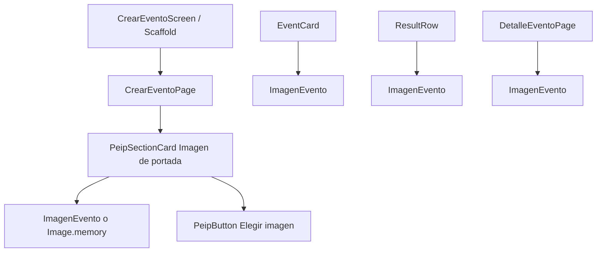
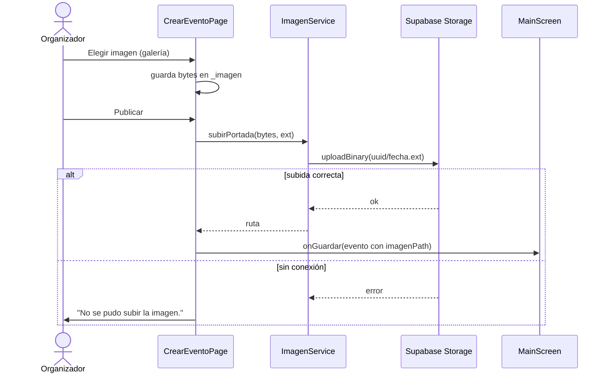

# [PLAN-004] Plan técnico: imágenes de portada de los eventos

## Metadatos
- ID: PLAN-004
- Spec asociada: [SPEC-004](../specs/almacenamiento-imagenes-spec.md)
- Autor: Jacobo Sandoval (Bloque D, entrega 4)
- Fecha: 2026-11-20
- Estado: READY_FOR_TASKS

## Resumen de la Solución
La imagen se guarda en Supabase Storage y en la tabla `evento` solo queda su
ruta, en la columna `imagen_path` que ya creó el Bloque A (RN-02).

1. Un bucket público llamado `portadas`. Es público porque los eventos se ven
   sin restricción (RN-03). Solo un usuario con sesión puede subir, y solo
   dentro de una carpeta con su propio uuid (RN-04).
2. Un servicio, `ImagenService`, que sube el archivo y arma la URL pública.
3. Un widget, `ImagenEvento`, que pinta la imagen y, si no hay, si está
   cargando o si falla, pinta el bloque de color de siempre.
4. El formulario de crear y editar evento gana un botón "Elegir imagen" que
   abre la galería con el paquete `image_picker`.

La imagen se sube al tocar "Publicar" o "Guardar borrador", no al elegirla.
Así, si el organizador cambia de idea antes de guardar, no quedan archivos
sueltos en el bucket.

## Reutilización Detectada
- Widgets: `PeipSectionCard` para la nueva sección del formulario y
  `PeipButton`, que con `onPressed: null` ya se ve deshabilitado.
- Tema: `colorImagenEvento(idEvento)` de `lib/theme/app_icons.dart` sigue
  siendo el color de respaldo.
- Modelo: `Evento.imagenPath` y su lectura y escritura en `fromMap`/`toMap`
  ya existen (Bloque C).
- Esquema: columna `evento.imagen_path text` (Bloque A, `01_schema.sql`).

## Impacto por Capa

### 0. Base de datos y configuración
| Archivo | Acción | Descripción |
| :--- | :--- | :--- |
| `supabase/04_storage.sql` | crear | Bucket `portadas` (público, máximo 5 MB, solo jpeg, png y webp) y la política de subida en la carpeta propia |
| `pubspec.yaml` | modificar | Agregar `image_picker` |
| `ios/Runner/Info.plist` | modificar | Texto del permiso de galería, que iOS exige |

### 1. Modelos (`lib/model/`)
Sin cambios. `imagenPath` ya existe.

### 2. Servicios (`lib/services/`)
| Archivo | Firma pública | Responsabilidad |
| :--- | :--- | :--- |
| `imagen_service.dart` | `Future<String> subirPortada(Uint8List bytes, String extension)` | Sube a `portadas/<uuid>/<fecha>.<ext>` y devuelve esa ruta. No captura errores |
| | `static String? urlPublica(String? ruta)` | Arma la URL pública. Es estática y no usa el cliente, para que los widgets y las pruebas no necesiten Supabase inicializado |

### 3. Widgets (`lib/widgets/`)
| Widget | Parámetros | Responsabilidad |
| :--- | :--- | :--- |
| `ImagenEvento` (nuevo) | `String? imagenPath`, `Color color`, `double? width`, `double? height`, `BorderRadius borderRadius`, `Widget? child` | `Image.network` con `loadingBuilder` y `errorBuilder` que devuelven el bloque de color |
| `EventCard` | sin cambios en su constructor | Cambia el `Container` de color por `ImagenEvento` |
| `ResultRow` | sin cambios en su constructor | Igual, conservando el icono de la categoría encima del color |

### 4. Pages (`lib/pages/`), sin Scaffold
| Page | Estado propio | Cambio |
| :--- | :--- | :--- |
| `CrearEventoPage` | Stateful (formulario) | Nueva sección "Imagen de portada" con vista previa y botón. Estado efímero: `_imagen`, `_extension` y `_subiendo`. `_guardar` pasa a ser asíncrono y sube la imagen antes de llamar a `onGuardar` |
| `DetalleEventoPage` | sin cambios | Cambia el `Container` de color por `ImagenEvento` |

### 5. Screens y rutas
Sin cambios. La firma de `onGuardar` no cambia: recibe un `Evento` que ya
trae la ruta de la imagen, y `MainScreen` lo guarda con `EventoService` del
Bloque C, que escribe `imagen_path` con `toMap`.

## Gestión de Estado
- Los bytes de la imagen elegida y la bandera `_subiendo` son estado efímero
  de formulario, así que viven en `CrearEventoPage`, como lo permiten las
  convenciones.
- El evento guardado sigue viviendo en `MainScreen`. Este bloque no agrega
  estado global.
- `ImagenEvento` es `StatelessWidget`: recibe la ruta por constructor y no
  sabe de navegación.

## Diagramas

### Árbol de widgets

### Publicar un evento con imagen

## Estrategia de Pruebas
| Escenario Gherkin | Prueba | Archivo |
| :--- | :--- | :--- |
| Evento sin imagen | widget test: sin ruta no hay `Image`, sí el icono sobre el color | `test/widgets/imagen_evento_test.dart` |
| Publicar un evento con imagen | widget test: con ruta pide la URL pública del bucket | `test/widgets/imagen_evento_test.dart` |
| La imagen no carga | manual: ruta inexistente muestra el bloque de color | `flutter run` |
| Falla la subida | manual: sin wifi, "Publicar" muestra el aviso y no sale del formulario | `flutter run` |

## Calidad y Riesgos
- `flutter analyze` sin advertencias y `flutter test` en verde.
- Dependencia nueva: `image_picker`. En Android no pide permisos porque usa el
  selector de fotos del sistema.
- Depende del Bloque B (sesión activa, para el uuid de la carpeta) y del
  Bloque C (`EventoService` escribe `imagen_path`).
- Fuera de alcance, según la spec: cámara, recorte y borrar la imagen vieja.