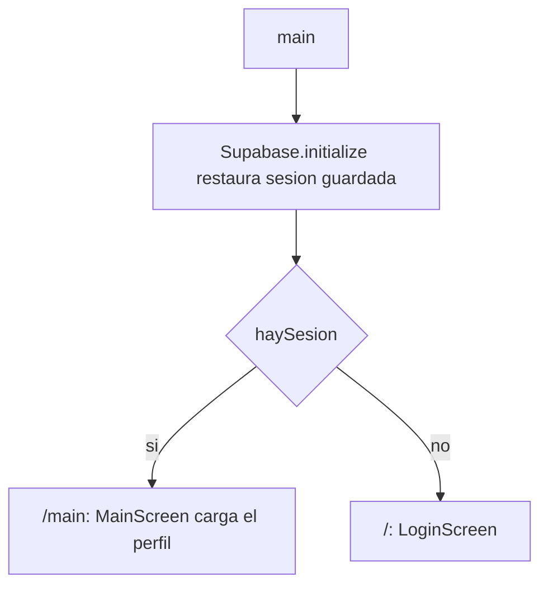
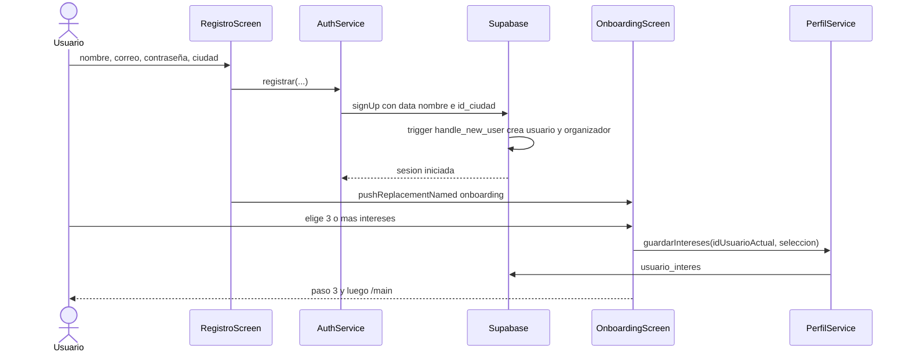
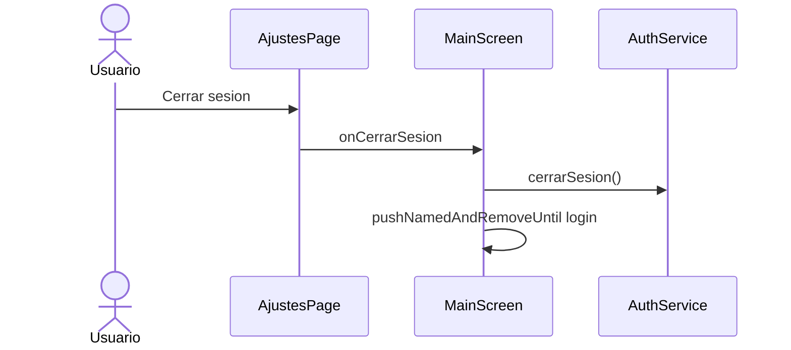

# [PLAN-002] Plan técnico: autenticación y sesión persistente

## Metadatos
- ID: PLAN-002
- Spec asociada: [SPEC-002](../specs/autenticacion-sesion-spec.md)
- Autor: Alejandro Arango (Bloque B, entrega 4)
- Fecha: 2026-11-16
- Estado: DRAFT

## Resumen de la Solución
Se conecta la aplicación con Supabase y se reemplaza la comparación contra `MockData.usuarios` por Supabase Auth.

1. `main.dart` inicializa Supabase con las llaves de `env.json`, leídas con `String.fromEnvironment`, igual que el repo del curso (`week-14/supabase-services-end`).
2. Dos servicios nuevos: `AuthService` para registro, inicio y cierre de sesión, y `PerfilService` para leer el perfil y guardar los intereses.
3. La guardia de sesión se resuelve al arrancar. Como `Supabase.initialize` restaura la sesión guardada antes de `runApp`, `main.dart` decide si la ruta inicial es `/` o `/main`. No hace falta Navigator 2.0 ni una pantalla intermedia.
4. El `Usuario` ya no viaja como argumento de ruta. Cada pantalla que lo necesita obtiene el id del usuario en sesión y lo pide a `PerfilService`.

El perfil y el organizador los crea el trigger `handle_new_user` del Bloque A (`supabase/01_schema.sql`) a partir de `nombre` e `id_ciudad` enviados en los metadatos del registro. La aplicación no inserta en `usuario`.

## Reutilización Detectada
- Widgets: `PeipButton` (con `onPressed: null` queda deshabilitado mientras carga), `PeipTextField`, `PeipFormField`, `PasoIndicador`, `InterestTile`, `LoadingState` y `ErrorState` (Bloque C, ya en `main`).
- Pages: `LoginPage`, `RegistroPage`, `OnboardingPage` y `PreferenciasPage` conservan su diseño. Solo cambia la firma de sus callbacks, que pasan a ser asíncronos.
- Servicios del Bloque C: `CatalogoService.cargar()` provee ciudades (registro) y categorías (onboarding).
- Modelos: `Usuario.fromMap` (Bloque C) arma el perfil a partir de la fila de `usuario`, el correo de la sesión, los intereses y los pesos de etiquetas.
- Esquema del Bloque A: tablas `usuario` (`id_usuario uuid`, `nombre`, `personalizacion_activa`, `id_ciudad`) y `usuario_interes`. Políticas: `ciudad` y `categoria` legibles por `anon`; `usuario` y `usuario_interes` solo por su dueño (`auth.uid() = id_usuario`).

## Impacto por Capa

### 0. Configuración del proyecto
| Archivo | Acción | Descripción |
| :--- | :--- | :--- |
| `pubspec.yaml` | modificar | Agregar `supabase_flutter` (misma versión del repo del curso, `^2.17.2`) |
| `lib/main.dart` | modificar | Inicializar Supabase con `SUPABASE_URL` y `SUPABASE_PUBLISHABLE_KEY` (ver sección 7) |

Ya resuelto en `main` por el Bloque C (commit `1efc55b`): `env.example.json` con las dos llaves vacías, `/env.json` en `.gitignore` y la sección "Variables de entorno" del README. Este bloque usa esos mismos nombres y no los vuelve a crear. Al terminar, se retira del README el "Usuario de prueba" precargado (RN-09 de la spec).

### 1. Modelos (`lib/model/`)
| Archivo | Acción | Descripción |
| :--- | :--- | :--- |
| `lib/model/models.dart` | modificar | `Usuario`: se elimina `contrasenaHash`, que `fromMap` ya llena con texto vacío porque la credencial vive en `auth.users` (RN-01) |

`idUsuario` como `String` (uuid) y `Usuario.fromMap` con el correo aparte ya los hizo el Bloque C (commits `0c4ee0a` y `d6e4ae3`). Al quitar `contrasenaHash` también se retiran `hashSimulado` y su uso en `mock_data.dart`, `LoginScreen` y `RegistroScreen`.

### 2. Servicios (`lib/services/`)
Clases sin estado, con `final _db = Supabase.instance.client` y el nombre de la tabla como constante, como en el repo del curso. No capturan excepciones: las dejan subir a la Screen.

| Archivo | Firma pública | Responsabilidad |
| :--- | :--- | :--- |
| `auth_service.dart` | `Future<void> iniciarSesion(String email, String password)` | Inicio de sesión con correo y contraseña |
| | `Future<void> registrar({required String nombre, required String email, required String password, required int idCiudad})` | Registro; envía `nombre` e `id_ciudad` en `data` para el trigger |
| | `Future<void> cerrarSesion()` | Cierra la sesión |
| | `bool get haySesion`, `String? get idUsuarioActual`, `String? get emailActual` | Consulta de la sesión vigente, sin red |
| `perfil_service.dart` | `Future<Usuario> cargar(String idUsuario)` | Lee `usuario`, sus intereses y sus pesos de etiquetas |
| | `Future<void> guardarIntereses(String idUsuario, Set<int> idCategorias)` | Reemplaza las filas de `usuario_interes` del usuario |

### 3. Utilidades (`lib/utils/`)
| Archivo | Firma pública | Responsabilidad |
| :--- | :--- | :--- |
| `mensajes_auth.dart` | `String mensajeAuth(Object error)` | Traduce errores del servicio a los mensajes de la spec: credenciales inválidas, correo ya registrado, contraseña débil y sin conexión. Cualquier otro error da un mensaje genérico, sin códigos técnicos |

### 4. Widgets (`lib/widgets/`)
Sin cambios.

### 5. Pages (`lib/pages/`), sin Scaffold
| Page | Estado propio | Cambio |
| :--- | :--- | :--- |
| `LoginPage` | Stateful (formulario) | `onLogin` pasa a `Future<String?> Function(String email, String password)`. Agrega `_cargando`; el botón queda deshabilitado mientras espera. Los controladores inician vacíos (RN-09) |
| `RegistroPage` | Stateful (formulario) | `onRegistro` pasa a `Future<String?> Function(...)` con el mismo manejo de `_cargando`. Las validaciones locales (nombre, correo, 6 caracteres) siguen en la Screen |
| `OnboardingPage` | Stateful (selección) | `onTerminar` pasa a `Future<String?> Function(Set<int>)`; muestra el error si el guardado falla y conserva la selección |
| `PreferenciasPage` | sin cambios | — |
| `AjustesPage` | sin cambios | El botón "Cerrar sesión" sigue llamando a `onCerrarSesion` |

### 6. Screens (`lib/screens/`)
| Screen | Page que hospeda | Cambio |
| :--- | :--- | :--- |
| `LoginScreen` | `LoginPage` | Llama a `AuthService.iniciarSesion`. Si funciona, `pushReplacementNamed(AppRoutes.main)` sin argumentos; si falla, devuelve `mensajeAuth(e)` |
| `RegistroScreen` | `RegistroPage` | Pasa a Stateful: carga ciudades con `CatalogoService` (muestra `LoadingState` o `ErrorState` con reintento). Valida, llama a `AuthService.registrar` y navega a onboarding sin argumentos |
| `OnboardingScreen` | `OnboardingPage` | Pasa a Stateful para cargar las categorías. Con selección, llama a `PerfilService.guardarIntereses`; con "Saltar" no guarda nada. Luego va a preferencias |
| `PreferenciasScreen` | `PreferenciasPage` | Navega a `/main` sin argumentos |
| `MainScreen` | — | Deja de leer `Usuario` de los argumentos. Obtiene el perfil con `PerfilService.cargar(idUsuarioActual)` dentro de la carga inicial del Bloque C. `_cerrarSesion` llama a `AuthService.cerrarSesion` y, falle o no, navega al login limpiando la pila |

### 7. Rutas y arranque (`lib/main.dart`, `lib/routes/`)
- `main()` pasa a `async`: `WidgetsFlutterBinding.ensureInitialized()`, `Supabase.initialize(url, publishableKey)` y `runApp`.
- `PeipApp` recibe `initialRoute` por constructor: `AppRoutes.main` si hay sesión, `AppRoutes.login` si no. Así las pruebas pueden construir la app sin Supabase.
- `AppRoutes.routes` no cambia. Las rutas `/onboarding`, `/preferencias` y `/main` dejan de recibir un `Usuario` como argumento.

## Gestión de Estado
- La sesión la guarda el SDK de Supabase en el dispositivo; la aplicación no la duplica. `AuthService` solo la consulta.
- El perfil del usuario sigue viviendo en `MainScreen`, que lo carga al entrar. Esto reemplaza el paso del `Usuario` por argumentos de ruta, que no funciona cuando la aplicación arranca directo en `/main`.
- Login, registro y onboarding mantienen solo estado efímero de formulario (`_cargando`, `_error`), como lo permiten las convenciones.
- Las Screens crean los servicios dentro de los manejadores, no en `build`. Así construir una pantalla no exige que Supabase esté inicializado, y los widget tests no lo necesitan.

## Diagramas

### Arranque de la aplicación

### Registro

### Cierre de sesión

## Estrategia de Pruebas
| Escenario Gherkin | Prueba | Archivo |
| :--- | :--- | :--- |
| Credenciales incorrectas | widget test de `LoginPage` con un `onLogin` falso que devuelve el mensaje: se ve debajo de los campos | `test/pages/login_page_test.dart` |
| Inicio de sesión (estado cargando) | widget test: con un `onLogin` que no termina, el botón no responde | `test/pages/login_page_test.dart` |
| Registro con contraseña corta / correo repetido | widget test de `RegistroPage` con `onRegistro` falso que devuelve el mensaje | `test/pages/registro_page_test.dart` |
| Saltar los intereses | widget test de `OnboardingPage`: "Continuar" deshabilitado con menos de tres; "Saltar" entrega un conjunto vacío | `test/pages/onboarding_page_test.dart` |
| Traducción de errores | unit test de `mensajeAuth` con las excepciones de credenciales, correo repetido y red | `test/utils/mensajes_auth_test.dart` |
| Registro exitoso, sesión recordada, cerrar sesión, contraseña fuera de los datos de PEIP | manual con `flutter run` contra el proyecto de Supabase y revisión de la tabla `usuario` en la consola | — |

Las Pages reciben callbacks, así que se prueban sin red. Los servicios dependen de Supabase y se verifican a mano, igual que en el plan del Bloque C.

## Calidad y Riesgos
- `flutter analyze` sin advertencias y `flutter test` en verde antes de cada commit. Sin `print`, constructores `const` donde aplique.
- Dependencia nueva: `supabase_flutter`. La pide el enunciado y es la misma del repo del curso.
- Dependencia con el Bloque A: el trigger y las tablas deben estar desplegados en el proyecto `oqgftzulvfedjxptbltl` para probar el registro.
- Dependencia con el Bloque C: `CatalogoService` para ciudades y categorías, y la carga inicial de `MainScreen` donde se llama a `PerfilService.cargar`.
- Decisión a confirmar: desactivar "Confirm email" en Authentication de Supabase (RN-04 de la spec). Si queda activa, `signUp` no devuelve sesión y el onboarding no puede guardar intereses por RLS.
- Decisión a confirmar: el Bloque C no lista un servicio de perfil. Se propone que `PerfilService` sea de este bloque y que el Bloque C lo consuma. El mismo servicio puede guardar después los cambios de intereses y personalización desde Ajustes, si el equipo asigna esa parte.
- `test/widget_test.dart` recorre la aplicación con datos en memoria y deja de servir cuando el login usa Supabase. Su ajuste ya está previsto en la Tarea 7 del Bloque C; aquí solo se garantiza que `PeipApp(initialRoute: AppRoutes.login)` se construye sin Supabase.
