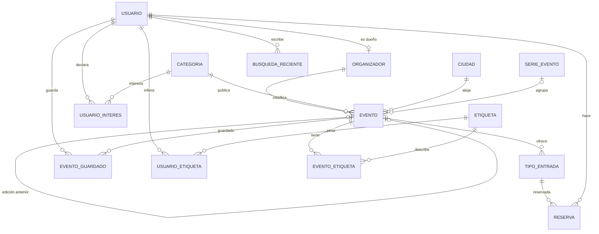
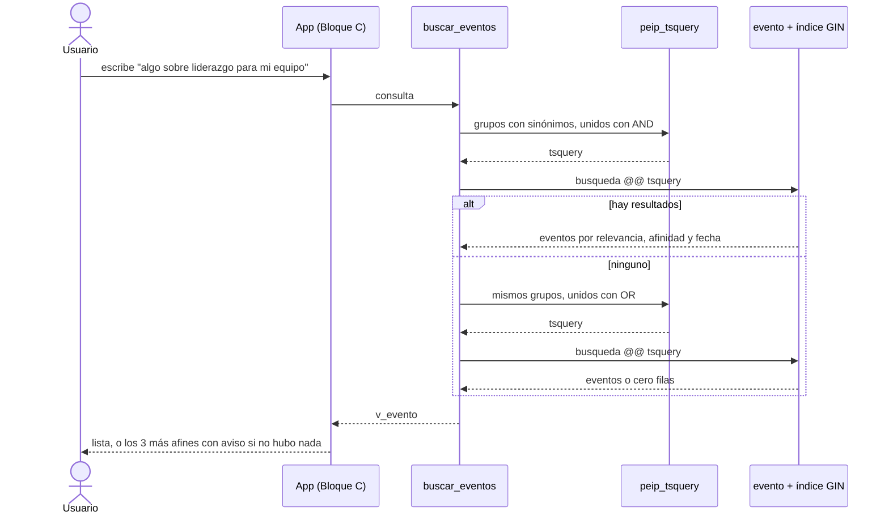

# [PLAN-001] Plan técnico: persistencia, aislamiento de datos y búsqueda por significado

## Metadatos
- ID: PLAN-001
- Spec asociada: [SPEC-001](../specs/base-datos-busqueda-spec.md)
- Autor: Santiago Laverde (Bloque A, entrega 4)
- Fecha: 2026-11-16
- Estado: DRAFT

## Resumen de la Solución
Este bloque no agrega pantallas. Mueve los datos de `lib/model/mock_data.dart` a una base de datos Postgres en Supabase y resuelve ahí tres cosas: el esquema, el aislamiento por usuario y la búsqueda con afinidad.

Todo se entrega en tres scripts SQL versionados en `supabase/`, que se ejecutan en orden:

1. `01_schema.sql`: tablas, índices, búsqueda de texto completo, función de afinidad, vista y funciones que consume la app.
2. `02_policies.sql`: seguridad por fila (RLS).
3. `03_seed.sql`: los mismos datos del prototipo y la cuenta de demostración.

La app no cambia en este bloque. Los otros tres bloques se conectan a lo que aquí queda definido (ver "Interfaces con otros bloques").

## Reutilización Detectada
- `lib/model/mock_data.dart`: fuente del seed. Se conservan los mismos ids de ciudades, categorías, etiquetas, organizadores, eventos y entradas, para que nada cambie al migrar.
- `lib/utils/busqueda.dart`: define la lógica que pasa a SQL. `calcularAfinidad` se vuelve la función `afinidad` y el diccionario `_sinonimos` se vuelve la tabla `sinonimo`. `buscarPorSignificado` se reemplaza por `buscar_eventos`.
- `peip_mer.sql` (entrega 1, escrito para Oracle): base del esquema, traducida a Postgres.
- `lib/model/models.dart`: no se toca aquí. El Bloque C le agrega `fromMap` y `toMap` y cambia `idUsuario` de int a String (uuid).

## Impacto por Capa

### 1. Base de datos (`supabase/`)
| Archivo | Acción | Descripción |
| :--- | :--- | :--- |
| `supabase/01_schema.sql` | crear | 15 tablas, índices, búsqueda, afinidad, vista y funciones |
| `supabase/02_policies.sql` | crear | RLS por usuario y funciones auxiliares |
| `supabase/03_seed.sql` | crear | Datos del prototipo y bloque idempotente de la cuenta demo |

#### Objetos que crea `01_schema.sql`
| Objeto | Tipo | Responsabilidad |
| :--- | :--- | :--- |
| `ciudad`, `categoria`, `etiqueta`, `serie_evento`, `organizador` | tablas | Catálogos del dominio |
| `usuario` | tabla | Perfil ligado a `auth.users` por uuid. No guarda correo ni contraseña |
| `evento`, `tipo_entrada`, `reserva`, `busqueda_reciente` | tablas | Núcleo del dominio |
| `evento_etiqueta`, `evento_guardado`, `usuario_interes`, `usuario_etiqueta` | tablas intermedias | Relaciones N a N |
| `sinonimo` | tabla | Equivalencias español a inglés para la búsqueda |
| `peip_es` | configuración de texto | Español sin tildes: `unaccent` más el stemmer en español |
| `handle_new_user` | trigger sobre `auth.users` | Crea el perfil y el organizador de cada cuenta nueva |
| `evento_vector` y triggers | funciones y triggers | Mantienen `evento.busqueda` al cambiar evento, etiquetas o categoría |
| `evento_busqueda_idx` | índice GIN | Acelera la búsqueda |
| `peip_tsquery` | función | Convierte la consulta en tsquery con sinónimos |
| `afinidad` | función | Reemplaza `calcularAfinidad` |
| `v_evento` | vista | Evento con etiquetas, precio mínimo y afinidad del usuario en sesión |
| `recomendar_eventos`, `buscar_eventos`, `buscar_eventos_tsq` | funciones | Listado ordenado y búsqueda por significado |

### 2. Widgets, Pages, Screens y Rutas
Sin cambios en este bloque. El Bloque C migra `MainScreen` y agrega los estados de carga y error. Los widgets siguen recibiendo datos por constructor.

## Decisiones de Diseño

- **La búsqueda va en la base y no en el teléfono.** Antes se traían todos los eventos y se filtraban en Dart. Ahora el filtro corre en Postgres con un índice, y el teléfono recibe solo lo que muestra. Se descartó pgvector con embeddings porque necesita una API externa y una llave, y si falla en vivo se cae la demo (ver sección 3 del documento de la entrega).
- **El tsvector se mantiene con triggers y no con una columna generada.** Una columna generada solo puede leer su propia fila, y la categoría y las etiquetas viven en otras tablas. Pesos: A título, B categoría y etiquetas, C eslogan, D descripción.
- **Sinónimos en una tabla.** El catálogo está en inglés ("Leadership", "team leadership") y las consultas en español. Sin la tabla, "liderazgo" no encuentra "leadership".
- **Búsqueda en dos pasos.** Primero se piden eventos que cubran todos los conceptos de la consulta (AND). Si no hay ninguno, se aceptan los que cubran alguno (OR). Así "algo sobre liderazgo para mi equipo" devuelve los tres eventos de liderazgo, igual que el prototipo, y una sola palabra también funciona.
- **Un organizador por cuenta.** El MER no ligaba usuario con organizador, y sin eso la RLS no puede saber quién es dueño de un evento. Se agrega `organizador.id_usuario` (nullable, único). Lo crea el trigger de alta, no la app, porque con confirmación de correo `signUp` no devuelve sesión y un insert desde el cliente fallaría por RLS.
- **Afinidad en SQL con la misma fórmula.** 2 puntos si la categoría está en los intereses, más la suma de pesos de las etiquetas, más 1 si es la ciudad; se divide entre 4, se limita de 0 a 1 y se mapea a 63-84.
- **Vista con `security_invoker`.** `v_evento` corre con los permisos de quien consulta, así que la RLS aplica y la afinidad es la del usuario en sesión. Con la personalización apagada la afinidad es null.
- **RLS con funciones auxiliares `security definer`.** Las políticas de `evento` y `tipo_entrada` se referirían entre sí y Postgres abortaría por recursión infinita. Las funciones `es_mi_organizador`, `es_dueno_evento` y `tengo_reserva_en_evento` leen sin pasar por la RLS.
- **Visibilidad de eventos.** Publicados: todos. Borradores y cancelados: solo el organizador dueño y quien tenga una reserva en ellos, para no romper "Mis tickets".

## Interfaces con otros bloques
| Bloque | Qué consume o debe hacer |
| :--- | :--- |
| B (Alejandro) | Mandar `nombre` e `id_ciudad` en `options.data` de `signUp`. El trigger crea el perfil y el organizador |
| C (Mateo) | Listar con `v_evento` o `recomendar_eventos(categoria)`, buscar con `buscar_eventos(texto)`, y si devuelve cero filas mostrar los tres más cercanos. Enviar fechas con `toUtc().toIso8601String()`. `codigo_qr` tiene valor por defecto |
| D (Jacobo) | Usar la columna `evento.imagen_path`. El bucket y sus políticas son de su bloque |

## Gestión de Estado
Este bloque no maneja estado de la app, que sigue en `MainScreen` (Bloque C). El estado persistente vive en Postgres. El aislamiento entre usuarios lo aplica la RLS en la base, y no depende de que la app filtre bien.

## Diagramas

### Modelo de datos

### Flujo de una búsqueda

## Estrategia de Pruebas
Este bloque es SQL, así que las pruebas son consultas de verificación contra una base con los tres scripts cargados, usando dos cuentas (Ana y Bob). `flutter test` no cubre este bloque y el test existente `test/widget_test.dart` no se afecta.

| Escenario Gherkin | Verificación |
| :--- | :--- |
| Búsqueda con una sola palabra | `buscar_eventos('liderazgo')` devuelve los eventos 9, 10 y 11 |
| Búsqueda en lenguaje natural | `buscar_eventos('algo sobre liderazgo para mi equipo')` devuelve exactamente 9, 10 y 11 |
| Sin tildes ni mayúsculas | `buscar_eventos('ESTADISTICA')` y `('estadística')` devuelven lo mismo |
| Cubre solo algunos conceptos | `buscar_eventos('liderazgo ventas')` devuelve los de liderazgo |
| Sin coincidencias | `buscar_eventos('pizza')` devuelve cero filas |
| Orden por afinidad | `recomendar_eventos()` como Ana: evento 10 con 84, evento 9 con 78, todos entre 63 y 84; coincide con la fórmula de Dart en los 13 eventos |
| Personalización apagada | Con `personalizacion_activa = false`, `afinidad` es null y el orden es por fecha |
| Filtro por categoría | `recomendar_eventos(2)` devuelve solo Leadership |
| Aislamiento | Bob ve 0 reservas, 0 guardados y 1 usuario; no puede borrar ni modificar lo de Ana |
| Borrador | El evento 4 lo ve Ana y no lo ve Bob ni anon |
| Evento con reserva | Con el evento 10 en borrador, Ana lo sigue viendo y Bob no |
| Solo el dueño modifica | Bob no puede editar, borrar ni crear eventos o entradas de Ana |
| Eliminar arrastra datos | Al borrar el evento 5 desaparecen sus entradas y guardados |
| Cuenta nueva | Al insertar en `auth.users` se crean `usuario` y `organizador` |
| Reconstruir desde cero | Los tres scripts corren sin error sobre una base vacía |

## Calidad y Riesgos
- Los scripts se probaron en Postgres 16 local con un emulador mínimo de Supabase (`auth.users`, `auth.uid()`, roles `anon` y `authenticated`). Falta probarlos en el proyecto real de Supabase (Postgres 17).
- Supuestos a confirmar en Supabase: que `unaccent` queda en el esquema `extensions` y que el SQL Editor deja crear el trigger sobre `auth.users`.
- La cuenta demo no se puede crear desde SQL. Hay que crear a Ana en Authentication y volver a correr el bloque final del seed, que es idempotente.
- Si se agregan columnas a `v_evento`, hay que recrear las funciones que devuelven `setof v_evento`.
- Cambio de comportamiento a revisar con el equipo: antes los borradores se veían para todos; ahora solo para su organizador.
- Dependencia para el Bloque C: `idUsuario` pasa de int a String (uuid) en los modelos de Dart.
- Decisiones abiertas: si la tabla de perfil se llama `usuario` (se mantuvo el nombre del MER) o `perfil`, y si `imagen_path` queda en este esquema o la crea el Bloque D.
