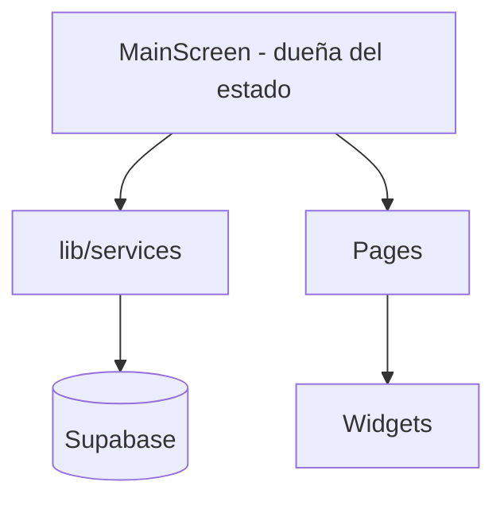
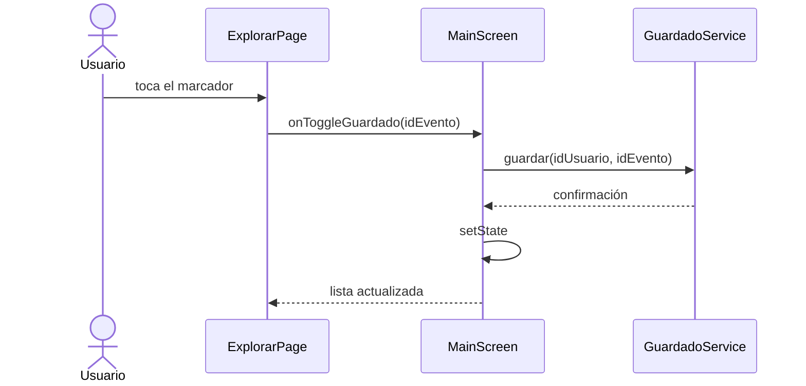

# [PLAN-003] Plan Técnico de Persistencia

## Metadatos
- ID: PLAN-003
- Spec asociada: [SPEC-003](../specs/persistencia-datos-spec.md)
- Fecha: 2026-11-16
- Estado: DRAFT

## Resumen de la Solución
Se introduce una capa de servicios entre `MainScreen` y Supabase. Cada servicio
traduce filas de la base a los modelos que la aplicación ya usa.

`MainScreen` sigue siendo la dueña del estado: lo que cambia es que sus listas
se llenan desde los servicios en lugar de `MockData`, y que gana dos campos
nuevos para representar la carga y el error de la carga inicial.

Las Pages y los widgets existentes no se modifican. Que no haya que tocarlos es
la señal de que la separación de la entrega anterior está bien hecha.

## Reutilización Detectada
- Modelos: las once clases de `lib/model/models.dart` se conservan; solo se les
  agrega conversión desde y hacia mapas.
- Widgets: `EmptyState` sirve de molde para los dos widgets nuevos. El resto
  (`EventCard`, `ResultRow`, `TicketTypeTile`, etc.) no cambia.
- Pages: ninguna cambia de firma.
- `MockData` se conserva durante la migración y se retira al final, cuando
  ninguna pantalla dependa de él.

## Impacto por Capa

### 1. Modelos (`lib/model/`)
| Archivo | Acción | Descripción |
| :--- | :--- | :--- |
| `lib/model/models.dart` | modificar | `fromMap` y `toMap` en cada clase |

Las fechas llegan como texto ISO 8601 y se convierten con `DateTime.parse`.
Los campos opcionales se leen con `as Tipo?`. `toMap` omite el identificador
cuando la fila es nueva, para que la base lo genere.

### 2. Servicios (`lib/services/`)
Clases sin estado. Cada una expone `final _db = Supabase.instance.client` y el
nombre de su tabla como constante, siguiendo el patrón visto en clase.

| Archivo | Acción | Responsabilidad |
| :--- | :--- | :--- |
| `catalogo_service.dart` | crear | Categorías, ciudades, etiquetas, organizadores y series. Solo lectura |
| `evento_service.dart` | crear | Listar eventos con sus tipos de entrada; crear, editar y eliminar |
| `guardado_service.dart` | crear | Listar, guardar y quitar eventos guardados |
| `reserva_service.dart` | crear | Listar reservas del usuario, crear y cancelar |
| `busqueda_service.dart` | crear | Listar, registrar y borrar búsquedas recientes |

Firmas públicas previstas:

- `CatalogoService.cargar()` devuelve los cinco catálogos en un registro.
- `EventoService.listar()`, `crear(evento, entradas)`, `actualizar(evento, entradas)`, `eliminar(idEvento)`.
- `GuardadoService.listar(idUsuario)`, `guardar(idUsuario, idEvento)`, `quitar(idUsuario, idEvento)`.
- `ReservaService.listar(idUsuario)`, `crear(reserva)`, `cancelar(idReserva)`.
- `BusquedaService.listar(idUsuario)`, `registrar(idUsuario, texto)`, `borrar(idBusqueda)`.

Ningún servicio captura excepciones: las deja subir para que `MainScreen`
decida qué mostrar.

### 3. Widgets Reutilizables (`lib/widgets/`)
| Widget | Parámetros / callbacks | Responsabilidad |
| :--- | :--- | :--- |
| `LoadingState` | `final String mensaje` | Indicador centrado durante la carga |
| `ErrorState` | `final String mensaje`, `VoidCallback onReintentar` | Mensaje de fallo con botón de reintento |

Ambos siguen la estructura de `EmptyState` y se exportan en `widgets.dart`.

### 4. Pages (`lib/pages/`)
Sin cambios. La carga inicial se resuelve en `MainScreen` antes de construir
las pestañas, y los fallos de una operación puntual se avisan con el
`ScaffoldMessenger` que ya se usa.

### 5. Screens (`lib/screens/`)
| Screen | Cambio |
| :--- | :--- |
| `MainScreen` | Carga desde servicios, estado de carga y de error |

Campos nuevos: `_cargando` (inicia en `true`) y `_error` (texto o nulo).
Método nuevo `_cargarTodo()`, invocado al resolverse el usuario y por el botón
de reintento. El `body` muestra `LoadingState`, `ErrorState` o el `IndexedStack`
según corresponda.

Cada método que escribe pasa a ser `Future<void>`: llama al servicio, espera
confirmación y solo entonces aplica `setState`. Si falla, muestra el aviso y no
modifica las listas.

### 6. Rutas y Navegación
Sin cambios.

## Gestión de Estado
El estado sigue viviendo en `MainScreen`. Los servicios no guardan nada: reciben
una petición y devuelven modelos.

Los datos bajan por constructor a las Pages y los eventos suben por callbacks,
igual que antes. Lo único que se agrega es que esos callbacks ahora esperan a
la base antes de actualizar la pantalla.

Se descartó mostrar el cambio de inmediato y revertirlo si falla: se siente más
rápido pero obliga a guardar el estado anterior de cada operación para poder
deshacerla, y la regla RN-02 de la spec pide lo contrario.

## Diagramas

### Capas

### Guardar un evento

## Estrategia de Pruebas
| Escenario Gherkin | Prueba | Archivo |
| :--- | :--- | :--- |
| Carga inicial | widget test de `LoadingState` | `test/widgets/loading_state_test.dart` |
| Error al cargar, con reintento | widget test de `ErrorState` | `test/widgets/error_state_test.dart` |
| Persistencia al reabrir | manual con `flutter run` | — |
| Operación que falla | manual, sin conexión | — |

Los escenarios que dependen de la base no se automatizan: necesitarían red o
un doble de prueba, y eso agrega más complejidad de la que esta entrega pide.
Se verifican a mano y queda registrado en las tareas.

`test/widget_test.dart` recorre hoy la aplicación con datos en memoria y dejará
de pasar cuando se retire `MockData`. Se reduce a comprobar que la pantalla de
login se construye.

## Calidad y Riesgos
- `flutter analyze` sin advertencias y `flutter test` en verde antes de cada
  commit.
- Dependencia: los servicios no compilan hasta que `supabase_flutter` esté
  agregado y el cliente inicializado en `main.dart`, que corresponde al bloque
  de autenticación.
- Pendiente: los nombres de tablas y columnas se toman del SQL de
  `supabase/01_schema.sql` cuando esté disponible. No se inventan aquí.
- Decisión abierta: con Supabase Auth el identificador de usuario deja de ser
  entero y pasa a ser un UUID. Afecta a `Usuario`, `Reserva`, `EventoGuardado`
  y `BusquedaReciente`. Se propone cambiar esos campos a texto. Debe
  confirmarse con los bloques de base de datos y autenticación antes de
  escribir `fromMap`.
